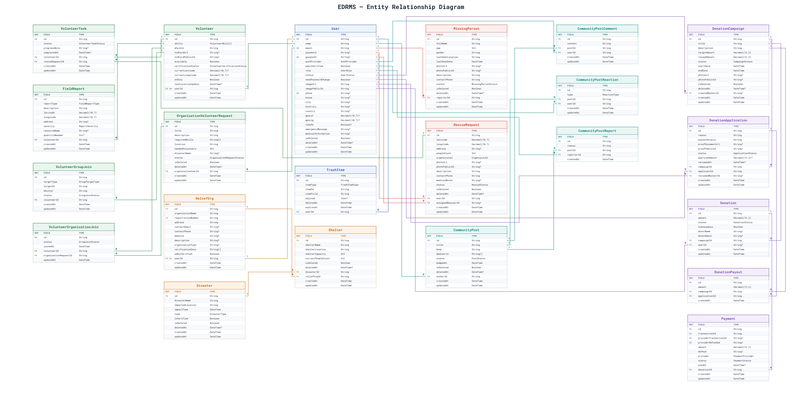

# EDRMS Backend Server

## 1. Introduction

EDRMS (Emergency Disaster Response & Management System) is a REST API that connects people affected by disasters in Bangladesh with volunteers, relief organizations and admins. Citizens report disasters, request rescue, post missing-person reports, confirm they are safe and donate to relief campaigns. Volunteers apply for verification, share live duty location, accept nearby rescue tasks and file field reports. Relief organizations publish disaster alerts, run shelters and donation campaigns and recruit volunteers. Admins verify volunteers, organizations and disasters, moderate community content and read dashboard reports. A Super Admin does everything an Admin can do and is the only role that can create new Admin accounts.

## 2. Live Link

- [Live API](https://edrms-express-server-ahmadzubayer.vercel.app/)
- [Live API documentation](https://edrms-express-server-ahmadzubayer.vercel.app/docs/) (local: <http://localhost:5000/docs>)
- Repository: [github.com/AhmadZubayer/EDRMS-Express-Server-WebDevL2-A6](https://github.com/AhmadZubayer/EDRMS-Express-Server-WebDevL2-A6)

## 3. Advanced Features

1. **Super Admin hierarchy**
   - **Problem:** Admin accounts must not be able to create other admins or promote themselves, otherwise one compromised admin can take over the whole system.
   - **Solution:** A fifth role, `SUPER_ADMIN`, is seeded from the environment. `auth(UserRole.ADMIN)` automatically lets the Super Admin through, so every admin route works for both, while `POST /api/admin/admins` (create an admin with an emailed temporary password and `needPasswordChange`), listing, blocking and deleting admins are Super Admin only. Only a Super Admin can grant or remove admin roles, nobody can block, delete or downgrade a Super Admin, and an admin cannot change their own role.
2. **Two payment gateways behind one interface (Strategy + Adapter + Factory)**
   - **Problem:** Stripe confirms through a signed webhook, bKash confirms through a browser redirect followed by a server-side `execute` call, but donations must behave identically.
   - **Solution:** `IPaymentProvider` is the contract, `stripe.provider.ts` and `bkash.provider.ts` are adapters and `paymentProvider.factory.ts` picks one at runtime. Both gateways end in the same guarded `PENDING -> COMPLETED` update inside one transaction that also marks the `Donation` as `PAID` and atomically increments the campaign `raisedAmount`, so confirming twice changes nothing. No gateway call happens inside a transaction.
3. **Redis-backed email OTP registration**
   - **Problem:** Storing unverified users in PostgreSQL leaves junk rows behind and OTPs in the database are easy to leak.
   - **Solution:** Registration stores the pending user (with a bcrypt hash) and a 6-digit OTP in Redis for 5 minutes. Nothing is written to PostgreSQL until the OTP is verified, forgot-password uses the same pattern, and OTPs are deleted the moment they are used.
4. **Safe payouts for donation applications**
   - **Problem:** Two admins could approve payouts that together exceed what a campaign actually raised.
   - **Solution:** Approval runs in a `Serializable` transaction that checks `raisedAmount` minus earlier payouts, creates a `DonationPayout` and moves the application out of `PENDING` with a guarded update, so the second reviewer gets a 409.
5. **Soft delete with a restorable trash**
   - **Problem:** Users delete missing-person reports, rescue requests and posts by mistake, but hard deletes lose evidence.
   - **Solution:** Deleting sets `isDeleted` and writes a `TrashItem` in the same transaction. Items can be restored or purged by their owner or an admin and a daily cron job purges items older than 30 days.
6. **Volunteer dispatch**
   - **Problem:** Rescue requests need the nearest verified, on-duty volunteer, and two volunteers must not take the same request.
   - **Solution:** Volunteers publish their duty location, nearby requests are ranked by Haversine distance and accepting a task is a guarded status change inside a transaction.

## 4. Project Structure

```text
EDRMS-Express-Server/
├── docs/
│   ├── DatabaseSchema.drawio
│   ├── DatabaseSchema.png
│   └── DatabaseSchema.svg
├── prisma/
│   ├── migrations/
│   │   ├── 20261115134132_init/
│   │   │   └── migration.sql
│   │   └── migration_lock.toml
│   ├── models/
│   │   ├── communityPost.prisma
│   │   ├── disaster.prisma
│   │   ├── donation.prisma
│   │   ├── enums.prisma
│   │   ├── missingPerson.prisma
│   │   ├── payment.prisma
│   │   ├── reliefOrg.prisma
│   │   ├── rescueRequest.prisma
│   │   ├── shelter.prisma
│   │   ├── trashItem.prisma
│   │   ├── user.prisma
│   │   └── volunteer.prisma
│   ├── schema.prisma
│   └── seed.ts
├── src/
│   ├── app/
│   │   ├── config/
│   │   │   └── index.ts
│   │   ├── interfaces/
│   │   │   └── index.ts
│   │   ├── lib/
│   │   │   ├── bkash.ts
│   │   │   ├── cloudinary.ts
│   │   │   ├── cron.ts
│   │   │   ├── googleAuth.ts
│   │   │   ├── logger.ts
│   │   │   ├── multer.ts
│   │   │   ├── nodemailer.ts
│   │   │   ├── prisma.ts
│   │   │   ├── redis.ts
│   │   │   ├── stripe.ts
│   │   │   └── swagger.ts
│   │   ├── middleware/
│   │   │   ├── checkAuth.ts
│   │   │   ├── globalErrorHandler.ts
│   │   │   ├── notFound.ts
│   │   │   ├── validateParams.ts
│   │   │   ├── validateQuery.ts
│   │   │   └── validateRequest.ts
│   │   ├── module/
│   │   │   ├── admin/
│   │   │   │   ├── admin.controller.ts
│   │   │   │   ├── admin.docs.ts
│   │   │   │   ├── admin.interface.ts
│   │   │   │   ├── admin.route.ts
│   │   │   │   ├── admin.service.ts
│   │   │   │   ├── admin.tables.ts
│   │   │   │   └── admin.validation.ts
│   │   │   ├── auth/
│   │   │   │   ├── auth.controller.ts
│   │   │   │   ├── auth.docs.ts
│   │   │   │   ├── auth.interface.ts
│   │   │   │   ├── auth.route.ts
│   │   │   │   ├── auth.service.ts
│   │   │   │   └── auth.validation.ts
│   │   │   ├── communityPost/
│   │   │   │   ├── communityPost.controller.ts
│   │   │   │   ├── communityPost.docs.ts
│   │   │   │   ├── communityPost.interface.ts
│   │   │   │   ├── communityPost.route.ts
│   │   │   │   ├── communityPost.service.ts
│   │   │   │   └── communityPost.validation.ts
│   │   │   ├── disaster/
│   │   │   │   ├── disaster.controller.ts
│   │   │   │   ├── disaster.docs.ts
│   │   │   │   ├── disaster.interface.ts
│   │   │   │   ├── disaster.route.ts
│   │   │   │   ├── disaster.service.ts
│   │   │   │   └── disaster.validation.ts
│   │   │   ├── donation/
│   │   │   │   ├── donation.controller.ts
│   │   │   │   ├── donation.docs.ts
│   │   │   │   ├── donation.interface.ts
│   │   │   │   ├── donation.route.ts
│   │   │   │   ├── donation.service.ts
│   │   │   │   └── donation.validation.ts
│   │   │   ├── missingPerson/
│   │   │   │   ├── missingPerson.controller.ts
│   │   │   │   ├── missingPerson.docs.ts
│   │   │   │   ├── missingPerson.interface.ts
│   │   │   │   ├── missingPerson.route.ts
│   │   │   │   ├── missingPerson.service.ts
│   │   │   │   └── missingPerson.validation.ts
│   │   │   ├── payment/
│   │   │   │   ├── providers/
│   │   │   │   │   ├── bkash/
│   │   │   │   │   │   ├── bkash.callback.ts
│   │   │   │   │   │   ├── bkash.controller.ts
│   │   │   │   │   │   ├── bkash.docs.ts
│   │   │   │   │   │   ├── bkash.provider.ts
│   │   │   │   │   │   └── bkash.route.ts
│   │   │   │   │   ├── stripe/
│   │   │   │   │   │   ├── stripe.controller.ts
│   │   │   │   │   │   ├── stripe.docs.ts
│   │   │   │   │   │   ├── stripe.provider.ts
│   │   │   │   │   │   ├── stripe.route.ts
│   │   │   │   │   │   └── stripe.webhook.ts
│   │   │   │   │   └── paymentProvider.factory.ts
│   │   │   │   ├── payment.controller.ts
│   │   │   │   ├── payment.docs.ts
│   │   │   │   ├── payment.interface.ts
│   │   │   │   ├── payment.route.ts
│   │   │   │   ├── payment.service.ts
│   │   │   │   └── payment.validation.ts
│   │   │   ├── reliefOrg/
│   │   │   │   ├── reliefOrg.controller.ts
│   │   │   │   ├── reliefOrg.docs.ts
│   │   │   │   ├── reliefOrg.interface.ts
│   │   │   │   ├── reliefOrg.route.ts
│   │   │   │   ├── reliefOrg.service.ts
│   │   │   │   └── reliefOrg.validation.ts
│   │   │   ├── rescueRequest/
│   │   │   │   ├── rescueRequest.controller.ts
│   │   │   │   ├── rescueRequest.docs.ts
│   │   │   │   ├── rescueRequest.interface.ts
│   │   │   │   ├── rescueRequest.route.ts
│   │   │   │   ├── rescueRequest.service.ts
│   │   │   │   └── rescueRequest.validation.ts
│   │   │   ├── shelter/
│   │   │   │   ├── shelter.controller.ts
│   │   │   │   ├── shelter.docs.ts
│   │   │   │   ├── shelter.interface.ts
│   │   │   │   ├── shelter.route.ts
│   │   │   │   ├── shelter.service.ts
│   │   │   │   └── shelter.validation.ts
│   │   │   ├── trash/
│   │   │   │   ├── trash.controller.ts
│   │   │   │   ├── trash.docs.ts
│   │   │   │   ├── trash.interface.ts
│   │   │   │   ├── trash.route.ts
│   │   │   │   ├── trash.service.ts
│   │   │   │   └── trash.validation.ts
│   │   │   ├── user/
│   │   │   │   ├── user.controller.ts
│   │   │   │   ├── user.docs.ts
│   │   │   │   ├── user.interface.ts
│   │   │   │   ├── user.route.ts
│   │   │   │   ├── user.service.ts
│   │   │   │   └── user.validation.ts
│   │   │   ├── volunteer/
│   │   │   │   ├── volunteer.controller.ts
│   │   │   │   ├── volunteer.docs.ts
│   │   │   │   ├── volunteer.interface.ts
│   │   │   │   ├── volunteer.route.ts
│   │   │   │   ├── volunteer.service.ts
│   │   │   │   └── volunteer.validation.ts
│   │   │   └── volunteerNetwork/
│   │   │       ├── volunteerNetwork.controller.ts
│   │   │       ├── volunteerNetwork.docs.ts
│   │   │       ├── volunteerNetwork.interface.ts
│   │   │       ├── volunteerNetwork.route.ts
│   │   │       ├── volunteerNetwork.service.ts
│   │   │       └── volunteerNetwork.validation.ts
│   │   ├── templates/
│   │   │   ├── admin-account-created.ejs
│   │   │   ├── disaster-alert.ejs
│   │   │   ├── forgot-password.ejs
│   │   │   ├── registration-otp.ejs
│   │   │   ├── relief-org-verified.ejs
│   │   │   ├── reset-password-success.ejs
│   │   │   └── welcome.ejs
│   │   └── utils/
│   │       ├── AppError.ts
│   │       ├── authCookies.ts
│   │       ├── catchAsync.ts
│   │       ├── jwt.ts
│   │       ├── sendEmail.ts
│   │       ├── sendResponse.ts
│   │       └── uploadToCloudinary.ts
│   ├── app.ts
│   └── server.ts
├── .gitignore
├── biome.json
├── package.json
├── prisma.config.ts
├── PROGRESS.md
├── README.md
├── tsconfig.json
└── tsup.config.ts
```

## 5. Database Schema

[](docs/DatabaseSchema.png)

The editable draw.io source is [docs/DatabaseSchema.drawio](docs/DatabaseSchema.drawio) (open it at [app.diagrams.net](https://app.diagrams.net)).

## 6. Project Specification

| Item                | Technology                                            |
| ------------------- | ----------------------------------------------------- |
| Project             | Express.js 5 with TypeScript (ESM)                    |
| ORM                 | Prisma 7 with the `@prisma/adapter-pg` driver adapter |
| Database            | Prisma Postgres (cloud PostgreSQL)                    |
| Cache and OTP store | Redis                                                 |
| Background jobs     | node-cron                                             |
| Deployment          | Vercel from GitHub (`Deployment` branch)              |
| Form validation     | Zod                                                   |
| Authentication      | JWT, bcrypt, email OTP and Google sign-in             |
| Payments            | Stripe and bKash (Strategy + Adapter)                 |
| Email               | Nodemailer with EJS templates                         |
| File uploads        | Multer (in memory) and Cloudinary                     |
| API documentation   | Swagger UI and OpenAPI                                |
| Logger              | Pino                                                  |
| Lint and format     | Biome                                                 |
| Build               | tsup                                                  |

## 7. Setup and Run

```bash
npm install
cp .env.example .env      # fill in every value
npx prisma migrate deploy
npx prisma generate
npm run db:seed           # creates the Super Admin and the first Admin
npm run dev               # http://localhost:5000, docs at /docs
```

Other scripts: `npm run build`, `npm start`, `npm run format:fix`, `npm run lint:check`.

Environment variables (see `.env.example`): `DATABASE_URL`, `JWT_ACCESS_SECRET`, `JWT_REFRESH_SECRET`, `REDIS_*`, `SMTP_*`, `CLOUDINARY_*`, `STRIPE_SECRET_KEY`, `STRIPE_WEBHOOK_SECRET`, `BKASH_*`, `GOOGLE_CLIENT_ID`, `SUPER_ADMIN_*` and `ADMIN_*`.

## 7.1 Sample Data

The 15 Bangladeshi sample records per entity (users from Sylhet, Sunamganj, Kurigram, Dhaka, Bhola and other districts, disasters such as the Sylhet flash flood and Cyclone Remal, shelters, missing persons, rescue requests, community posts, campaigns and donations) were pushed through the live endpoints, not inserted into the database directly.

## 8. Features

Endpoints are listed with their full path. Admin routes are also open to the Super Admin.

| No. | Method | Endpoint | Access |
| --- | --- | --- | --- |
| 1 | `GET` | `/` | Public |
| 2 | `GET` | `/docs` | Public |
| 3 | `GET` | `/api/admin/accounts` | Admin / Super Admin |
| 4 | `POST` | `/api/admin/accounts` | Admin / Super Admin |
| 5 | `DELETE` | `/api/admin/accounts/:id` | Admin / Super Admin |
| 6 | `PATCH` | `/api/admin/accounts/:id/restore` | Admin / Super Admin |
| 7 | `PATCH` | `/api/admin/accounts/:id/role` | Admin / Super Admin |
| 8 | `GET` | `/api/admin/admins` | Super Admin |
| 9 | `POST` | `/api/admin/admins` | Super Admin |
| 10 | `DELETE` | `/api/admin/admins/:id` | Super Admin |
| 11 | `PATCH` | `/api/admin/admins/:id/status` | Super Admin |
| 12 | `GET` | `/api/admin/community-posts` | Admin / Super Admin |
| 13 | `DELETE` | `/api/admin/community-posts/:id` | Admin / Super Admin |
| 14 | `PATCH` | `/api/admin/community-posts/:id/restore` | Admin / Super Admin |
| 15 | `PATCH` | `/api/admin/community-posts/:id/status` | Admin / Super Admin |
| 16 | `GET` | `/api/admin/disasters` | Admin / Super Admin |
| 17 | `POST` | `/api/admin/disasters` | Admin / Super Admin |
| 18 | `PATCH` | `/api/admin/disasters/:id/verify` | Admin / Super Admin |
| 19 | `GET` | `/api/admin/relief-orgs` | Admin / Super Admin |
| 20 | `PATCH` | `/api/admin/relief-orgs/:id/verify` | Admin / Super Admin |
| 21 | `GET` | `/api/admin/reports` | Admin / Super Admin |
| 22 | `GET` | `/api/admin/rescue-requests` | Admin / Super Admin |
| 23 | `POST` | `/api/admin/rescue-requests` | Admin / Super Admin |
| 24 | `GET` | `/api/admin/tables` | Admin / Super Admin |
| 25 | `GET` | `/api/admin/tables/:tableName` | Admin / Super Admin |
| 26 | `GET` | `/api/admin/volunteers` | Admin / Super Admin |
| 27 | `PATCH` | `/api/admin/volunteers/:id/verify` | Admin / Super Admin |
| 28 | `POST` | `/api/auth/change-password` | Any logged-in user |
| 29 | `POST` | `/api/auth/forgot-password` | Public |
| 30 | `POST` | `/api/auth/google` | Public |
| 31 | `POST` | `/api/auth/login` | Public |
| 32 | `POST` | `/api/auth/logout` | Public |
| 33 | `GET` | `/api/auth/me` | Any logged-in user |
| 34 | `POST` | `/api/auth/refresh-token` | Public |
| 35 | `POST` | `/api/auth/register` | Public |
| 36 | `POST` | `/api/auth/reset-password` | Public |
| 37 | `POST` | `/api/auth/verify-email` | Public |
| 38 | `GET` | `/api/community-posts` | Public |
| 39 | `POST` | `/api/community-posts` | Any logged-in user |
| 40 | `GET` | `/api/community-posts/:id` | Public |
| 41 | `PATCH` | `/api/community-posts/:id` | Any logged-in user |
| 42 | `DELETE` | `/api/community-posts/:id` | Any logged-in user |
| 43 | `PATCH` | `/api/community-posts/:id/bump` | Any logged-in user |
| 44 | `GET` | `/api/community-posts/:id/comments` | Public |
| 45 | `POST` | `/api/community-posts/:id/comments` | Any logged-in user |
| 46 | `DELETE` | `/api/community-posts/:id/comments/:commentId` | Any logged-in user |
| 47 | `POST` | `/api/community-posts/:id/react` | Any logged-in user |
| 48 | `POST` | `/api/community-posts/:id/report` | Any logged-in user |
| 49 | `PATCH` | `/api/community-posts/:id/status` | Any logged-in user |
| 50 | `GET` | `/api/disasters` | Public |
| 51 | `POST` | `/api/disasters` | Relief Org / Admin / Super Admin |
| 52 | `GET` | `/api/disasters/:id` | Public |
| 53 | `PATCH` | `/api/disasters/:id` | Relief Org / Admin / Super Admin |
| 54 | `DELETE` | `/api/disasters/:id` | Relief Org / Admin / Super Admin |
| 55 | `PATCH` | `/api/disasters/:id/mark-safe` | Relief Org / Admin / Super Admin |
| 56 | `GET` | `/api/donations/applications` | Relief Org / Admin / Super Admin |
| 57 | `PATCH` | `/api/donations/applications/:id/review` | Relief Org / Admin / Super Admin |
| 58 | `GET` | `/api/donations/campaigns` | Public |
| 59 | `POST` | `/api/donations/campaigns` | Relief Org / Admin / Super Admin |
| 60 | `GET` | `/api/donations/campaigns/:id` | Public |
| 61 | `PATCH` | `/api/donations/campaigns/:id` | Relief Org / Admin / Super Admin |
| 62 | `DELETE` | `/api/donations/campaigns/:id` | Relief Org / Admin / Super Admin |
| 63 | `GET` | `/api/donations/campaigns/:id/applications` | Relief Org / Admin / Super Admin |
| 64 | `POST` | `/api/donations/campaigns/:id/apply` | Any logged-in user |
| 65 | `POST` | `/api/donations/campaigns/:id/donate` | Public |
| 66 | `GET` | `/api/donations/campaigns/:id/transactions` | Relief Org / Admin / Super Admin |
| 67 | `GET` | `/api/donations/my-applications` | Any logged-in user |
| 68 | `GET` | `/api/donations/my-donations` | Any logged-in user |
| 69 | `GET` | `/api/missing-persons` | Public |
| 70 | `POST` | `/api/missing-persons` | Any logged-in user |
| 71 | `GET` | `/api/missing-persons/:id` | Public |
| 72 | `PATCH` | `/api/missing-persons/:id` | Any logged-in user |
| 73 | `DELETE` | `/api/missing-persons/:id` | Any logged-in user |
| 74 | `PATCH` | `/api/missing-persons/:id/status` | Any logged-in user |
| 75 | `GET` | `/api/missing-persons/my` | Any logged-in user |
| 76 | `GET` | `/api/payments` | Any logged-in user |
| 77 | `GET` | `/api/payments/:id` | Any logged-in user |
| 78 | `GET` | `/api/payments/bkash/callback` | Public |
| 79 | `POST` | `/api/payments/create` | Any logged-in user |
| 80 | `GET` | `/api/payments/return/cancel` | Public |
| 81 | `GET` | `/api/payments/return/success` | Public |
| 82 | `POST` | `/api/payments/webhook` | Public |
| 83 | `GET` | `/api/relief-orgs` | Public |
| 84 | `GET` | `/api/relief-orgs/:id` | Public |
| 85 | `GET` | `/api/relief-orgs/:id/documents` | Admin / Super Admin |
| 86 | `PATCH` | `/api/relief-orgs/:id/verify` | Admin / Super Admin |
| 87 | `GET` | `/api/relief-orgs/profile/me` | Any logged-in user |
| 88 | `POST` | `/api/relief-orgs/sign-up` | Any logged-in user |
| 89 | `GET` | `/api/rescue-requests` | Public |
| 90 | `POST` | `/api/rescue-requests` | Any logged-in user |
| 91 | `GET` | `/api/rescue-requests/:id` | Public |
| 92 | `PATCH` | `/api/rescue-requests/:id` | Any logged-in user |
| 93 | `DELETE` | `/api/rescue-requests/:id` | Any logged-in user |
| 94 | `PATCH` | `/api/rescue-requests/:id/cancel` | Any logged-in user |
| 95 | `PATCH` | `/api/rescue-requests/:id/status` | Any logged-in user |
| 96 | `GET` | `/api/rescue-requests/my` | Any logged-in user |
| 97 | `GET` | `/api/shelters` | Public |
| 98 | `POST` | `/api/shelters` | Relief Org / Admin / Super Admin |
| 99 | `GET` | `/api/shelters/:id` | Public |
| 100 | `PATCH` | `/api/shelters/:id` | Relief Org / Admin / Super Admin |
| 101 | `DELETE` | `/api/shelters/:id` | Relief Org / Admin / Super Admin |
| 102 | `GET` | `/api/trash` | Any logged-in user |
| 103 | `DELETE` | `/api/trash/:id` | Any logged-in user |
| 104 | `POST` | `/api/trash/:id/restore` | Any logged-in user |
| 105 | `PUT` | `/api/users/complete-profile` | Any logged-in user |
| 106 | `PATCH` | `/api/users/is-safe` | Any logged-in user |
| 107 | `GET` | `/api/users/profile` | Any logged-in user |
| 108 | `PATCH` | `/api/users/update-profile` | Any logged-in user |
| 109 | `PATCH` | `/api/volunteers/:id/verification` | Admin / Super Admin |
| 110 | `PATCH` | `/api/volunteers/duty/location` | Any logged-in user |
| 111 | `GET` | `/api/volunteers/field-reports` | Relief Org / Admin / Super Admin |
| 112 | `GET` | `/api/volunteers/field-reports/my` | Any logged-in user |
| 113 | `POST` | `/api/volunteers/field-reports/routes` | Any logged-in user |
| 114 | `POST` | `/api/volunteers/field-reports/shortages` | Any logged-in user |
| 115 | `GET` | `/api/volunteers/group-joins/my` | Any logged-in user |
| 116 | `GET` | `/api/volunteers/me` | Any logged-in user |
| 117 | `PATCH` | `/api/volunteers/me` | Any logged-in user |
| 118 | `POST` | `/api/volunteers/missing-person-groups/:id/join` | Any logged-in user |
| 119 | `GET` | `/api/volunteers/organization-applications` | Relief Org |
| 120 | `PATCH` | `/api/volunteers/organization-applications/:id` | Relief Org |
| 121 | `GET` | `/api/volunteers/organization-requests` | Any logged-in user |
| 122 | `POST` | `/api/volunteers/organization-requests` | Relief Org |
| 123 | `PATCH` | `/api/volunteers/organization-requests/:id` | Relief Org |
| 124 | `DELETE` | `/api/volunteers/organization-requests/:id` | Relief Org |
| 125 | `POST` | `/api/volunteers/organization-requests/:id/join` | Any logged-in user |
| 126 | `GET` | `/api/volunteers/organization-requests/my-created` | Relief Org |
| 127 | `GET` | `/api/volunteers/organization-requests/my/joins` | Any logged-in user |
| 128 | `POST` | `/api/volunteers/register` | Any logged-in user |
| 129 | `POST` | `/api/volunteers/rescue-groups/:id/join` | Any logged-in user |
| 130 | `GET` | `/api/volunteers/rescue-requests/nearby` | Any logged-in user |
| 131 | `POST` | `/api/volunteers/rescue-tasks/:requestId/accept` | Any logged-in user |
| 132 | `POST` | `/api/volunteers/rescue-tasks/:requestId/reject` | Any logged-in user |
| 133 | `PATCH` | `/api/volunteers/rescue-tasks/:taskId/complete` | Any logged-in user |
| 134 | `PATCH` | `/api/volunteers/rescue-tasks/:taskId/progress` | Any logged-in user |
| 135 | `GET` | `/api/volunteers/rescue-tasks/my` | Any logged-in user |
| 136 | `POST` | `/api/volunteers/verification/apply` | Any logged-in user |

## 9. User Journey

### 9.1 Super Admin

```text
Login ──► Dashboard (/api/admin/reports)
   ├──► Create Admin (temporary password emailed, forced change on first login)
   ├──► Block / unblock / delete Admins
   ├──► Grant or remove the ADMIN role
   └──► Everything an Admin can do
```

### 9.2 Admin

```text
Login ──► Manage accounts (create, change role, soft delete, restore)
   ├──► Verify volunteers (VERIFIED / REJECTED) and relief organizations
   ├──► Create and verify disasters, create rescue requests for callers
   ├──► Moderate community posts (flag, hide, remove, restore)
   ├──► Review donation applications (approve with amount / reject)
   └──► Reports and a read-only table browser
```

### 9.3 User (citizen)

```text
Register ──► Email OTP (Redis, 5 min) ──► Verify ──► Login (or Sign in with Google)
   ├──► Complete profile (address, GPS, medical info) ──► Mark "I am safe"
   ├──► Report a rescue request ──► track status ──► cancel
   ├──► Report a missing person ──► update status
   ├──► Community posts: post, react, comment, report
   ├──► Donate to a campaign with Stripe or bKash
   ├──► Apply for relief funds with proof
   └──► Restore deleted items from the trash (30 days)
```

### 9.4 Volunteer

```text
Register as volunteer ──► Apply for verification (NID upload) ──► Admin verifies
   ├──► Go on duty with live location ──► see nearby rescue requests
   ├──► Accept / reject a task ──► update progress ──► complete
   ├──► File blocked-route and resource-shortage field reports
   └──► Join relief-organization volunteer requests and rescue / missing-person groups
```

### 9.5 Relief organization

```text
Sign up with registration documents ──► Admin verifies
   ├──► Publish disasters and alerts (emails verified users)
   ├──► Create shelters with capacity tracking
   ├──► Create donation campaigns and review applications
   └──► Open volunteer requests and approve applicants
```

## 10. Development Notes

### Architecture

Express 5 + TypeScript (ESM), Prisma 7 on PostgreSQL through a driver adapter and Redis for OTPs. One module per resource lives in `src/app/module/<name>/` with six files: route, controller, service, validation, interface and docs. Controllers are wrapped in `catchAsync` and answer through `sendResponse`; services own every Prisma call and throw `AppError`; Zod schemas validate body, params and query. Swagger comes from the `@openapi` blocks in each `*.docs.ts` file. `src/app.ts` builds the app and never listens; `src/server.ts` connects the database, Redis and the mailer, starts cron and then listens.

### Design decisions

- **Roles.** `USER`, `VOLUNTEER`, `RELIEF_ORG`, `ADMIN`, `SUPER_ADMIN`. Registering a volunteer or relief organization upgrades the role in the same transaction that creates the profile row.
- **Decimals.** Money and coordinates use Prisma `Decimal`; latitude and longitude of rescue requests are returned as numbers.
- **No outside call inside a transaction.** Payment gateways, email and Cloudinary run before or after database transactions.
- **Soft delete.** Missing persons, rescue requests, posts, disasters, shelters and campaigns are soft deleted; list queries always filter `isDeleted: false`.
- **Safe errors.** Every failure has one JSON shape and production responses never include stack traces.

## 11. Project Development

Completed by Ahmad Zubayer during the Next Level Development course at Programming Hero.

## 12. Use of AI

Claude Code was used to convert the project to Express, brainstorm the module structure, write boilerplate, fix errors and draft documentation.

## 13. Deployment (Vercel)

The `Deployment` branch adds `api/index.js` (re-exports the bundled Express app from `dist/app.js`), `public/.gitkeep` (static output folder), and `vercel.json` (`npm run build`, function packaging with the Swagger doc files and EJS templates, rewrite of every path to the function). Import the repository in Vercel, pick the `Deployment` branch as the production branch, keep the Other framework preset and add the same variables as `.env.example` (`NODE_ENV=production`, `DATABASE_URL`, `SERVER_URL`, `FRONTEND_URL`, JWT, Redis, SMTP, Cloudinary, Stripe, bKash and Google values). Apply migrations once with `npm run db:deploy` and seed with `npm run db:seed` against the production database.
